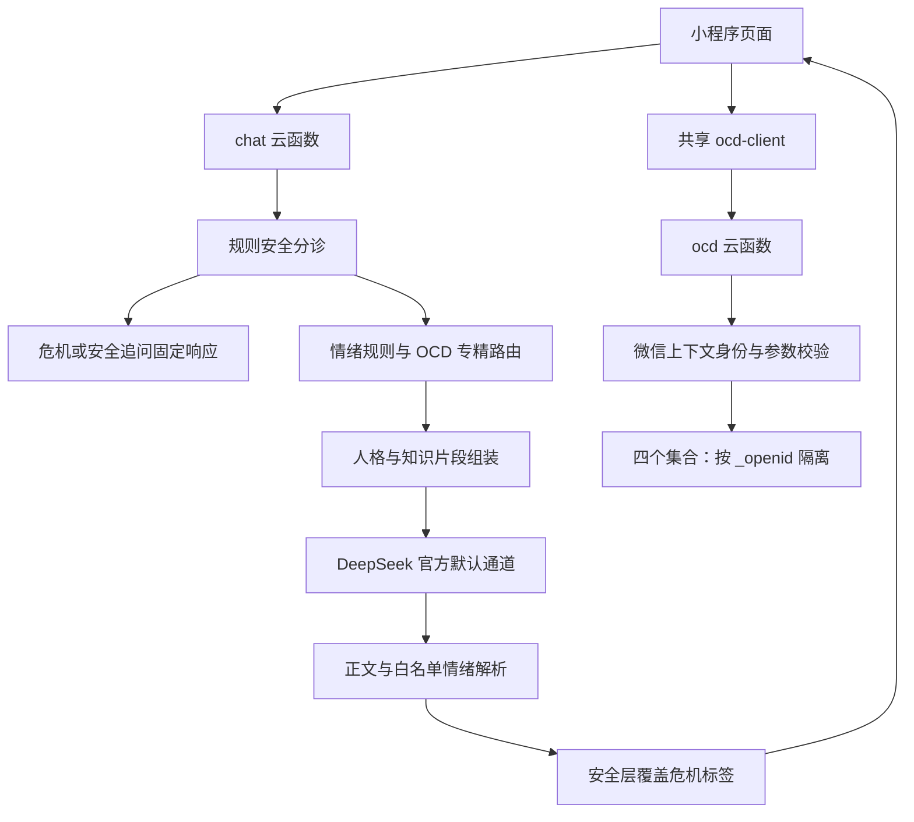

# 架构与维护边界

## 对话链路

`chat/index.js` 保持既有编排、六类返回点和有界重试。安全规则在模型调用之前执行；on 模式的明确危机使用固定文案，不依赖密钥和模型返回。
off/shadow/on 保留原语义，shadow 的对照结果不能当作已启用新路由。
`safety-router.js` 是原包逐字保留的纯函数，由原有安全用例与 SHA-256 同时保护。

`emotion.js` 先处理规则候选；`model-output.js` 仅接受普通情绪白名单。模型即使返回 crisis 也不能自行获得危机判定权；最终覆盖由安全层执行。
`ocd-router.js` 保持原有十类亚型和八类共病信号。共病信号实际为 depression、anxiety、sleep、substance、adhd、tic、eating、trauma。
这些信号属于交互路由线索，不是诊断。`ocd-prompt.js` 与 `ocd-knowledge.js` 只在服务端组装专业上下文。

前端 `chat-safety.js` 与 `chat-emotion.js` 处理回包兼容、危机粘性和表情，不获得模型密钥或完整服务端提示词。
固定 AI 提示保留在 chat.wxml。

## 数据链路

`ocd/index.js` 只信任微信上下文 OPENID。所有查询按 `_openid` 限定；稳定文档 ID 用于减少重试产生的重复档案、练习和自评记录。
稳定 ID 不等同于所有操作均有跨请求事务保证；多个接口的组合保存仍可能部分成功，前端沿用重试流程。
`logic.js` 校验文本、数值、题数、同意与记录字段。自评条目位于前端 `assess-items.js`，逐字保留。

恐惧阶梯、症状日志与工具首页通过 `miniprogram/utils/ocd-client.js` 共享云调用解包与错误处理。
需要独立确认同意的 payload 原样传递；封装不自动代填同意，不修改服务器鉴权。
自评页和删除入口保留已有专门交互。

## 隐私与存储

- 心情、番茄钟、冥想、手记等原有日常工具使用本地 `jianan_*` storage。
- 档案、症状/暴露日志、阶梯、自评在单独同意后写入云数据库。
- 项目不向数据库写入对话历史；用户消息会通过云函数转发至配置的模型服务。
- 规则日志主要记录分流摘要；现有上游错误处理可能包含截断的错误响应，部署方仍需确认日志访问、脱敏与留存策略。
- 云端“删除我的 OCD 数据”只删除当前用户四个集合中的记录；不等同于删除设备备份、平台日志或上游服务留存。

## 检查边界

`scripts/check-integrity.js` 解析 JavaScript 语法和静态 require/import、校验最近 package.json 的依赖声明、页面注册文件、Tab 图标、静态页面跳转、WXML/WXSS 静态资源和受保护文件。
云函数运行时代码不能依赖部署目录之外的相对模块。检查包含路径大小写，避免 Windows 正常而 Linux CI 失败。
模板动态绑定、远程资源、服务商可用性和微信专有编译行为仍需要平台验证。

本次保留各模块已有边界，没有把云函数内部模块移到根目录共享，保证独立打包。安全规则和量表不参与自动格式化。
新增 JSDoc 聚焦可复用函数与编排接口；微信 Page 生命周期和内部事件方法沿用现有命名。
